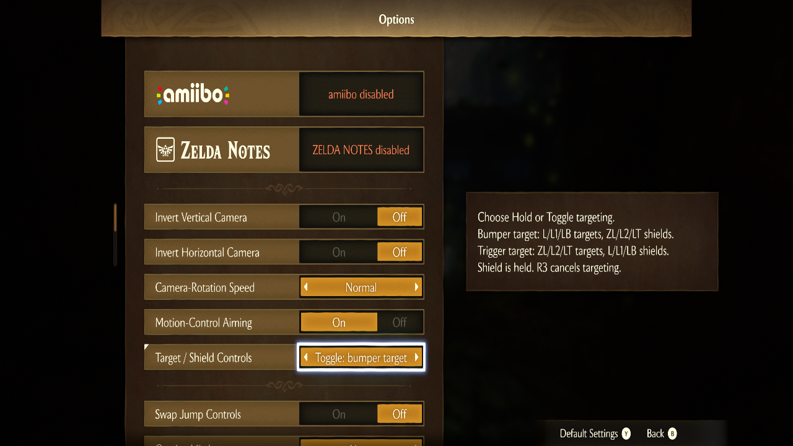

# Target and shield settings

In Hero Mode and Manual Shield, open **System > Options > Target / Shield Controls**. This replaces the original Targeting Type row; Swap Jump Controls remains separate.

| Choice | Target | Hold shield |
|---|---|---|
| Hold: bumper target | Hold L / L1 / LB | ZL / L2 / LT |
| Toggle: bumper target | Press L / L1 / LB | ZL / L2 / LT |
| Hold: trigger target | Hold ZL / L2 / LT | L / L1 / LB |
| Toggle: trigger target | Press ZL / L2 / LT | L / L1 / LB |

Hold targeting ends when released. Toggle targeting ends on the next press. Press the right stick (R3) to cancel targeting. Shield is always held, independently of targeting. R / R1 / RB remains the Hero item wheel; ZR / R2 / RT uses the equipped item. No emulator controller profile is included.

Close Options normally to save. The choice persists across game restarts. Existing Hold/Toggle choices are respected instead of overriding the displayed setting. Before removing/downgrading this settings-capable mod, select a **bumper target** choice and close Options: the trigger choices extend the targeting enum and old packages do not recognize them.

Use one Hero or Manual Shield package. Standalone Item Wheel does not add manual shielding or this setting. This update overrides Bootup's option table, GameData's targeting enum, localized option-message archives and resource budgets. Mods replacing those files require merging. The added setting text is currently English in every language.

