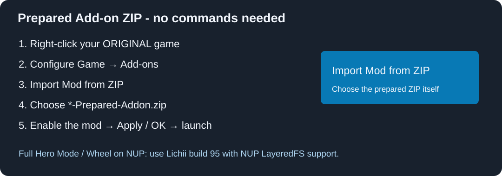

# Install or upgrade the current version

**Use your original unmodified game and the Prepared Add-on ZIP. No NUP/game is included in the download. No Python or CMD step is required.**

1. Close the game and use Lichii build95 or newer with the matching game version below.
2. Download `*-Prepared-Addon.zip` from the current release.
3. Right-click the **original game** > **Configure Game > Add-ons**.
4. Disable/remove the older Hero Mode, standalone shield or wheel package. Choose **Import Mod from ZIP** and select the new Prepared Add-on ZIP.
5. Enable the new package and **Dynamic FPS by Dark (built-in)**. Keep the normal game-speed limit at 100%. Apply/OK and launch the original game.



Hero Mode already includes wheel and shield: enable one complete native package. The matching standalone Dynamic-fps IPS can be used instead of the built-in FPS fix; do not install several different FPS fixes. The checked 3440x1440 ultrawide IPS can remain enabled. Other mods replacing the same UI/RomFS archive still require a merged resource.

The latest timing repair preserves the original main text extent and loads our added code with an included IPS sidecar. **Keep every file inside the prepared ZIP together.** The sidecar is essential; copying only `exefs/main` will not work.

## Upgrading from an older patched NUP

Older installers created a separate `heromode.nup` game copy. That method is historical. To get the current timing fix, launch your **original** NUP with this release's Add-on instead. Do not apply the new ZIP on top of a previously patched NUP. Your original game was not modified by the old builder. Original and patched copies have the same title ID, so the normal emulator profile can use the same save data.

The original game keeps its usual library title. Check **Configure Game > Info > Filename** to distinguish it from an older patched copy; do not use file size alone. No game NUP is distributed inside these releases.

## Optional builder

Most users should download the Prepared Add-on instead. If rebuilding from your own game, extract the Optional-Builder ZIP, run `Install-Windows.cmd`, choose the original matching NUP and a new output ZIP name. This now produces an **Add-on ZIP for every variant**, not another game copy. Import the generated ZIP using the same steps above. Python 3.11+ and the pinned requirements are needed only for this optional route.

For a source checkout:

```powershell
py -3 -m pip install -r requirements.txt
py -3 install.py --source "D:/Games/original.nup" --variant hero-with-stamina --output "D:/Mods/Hero-Mode"
```

Import the generated folder containing `exefs/` and `romfs/` through **Import Mod from Folder**. Choose a new/empty output folder. Wrong source hashes stop the build. `--patched-nup` is deliberately rejected for current IPS-sidecar releases because it would bypass the required Add-ons loading step.

## Requirements and removal

Requires title **0400486024DEC000**, update **131072**, main build **E0F3CCFAF50065AE4EA01EB5AEB13B1A45DA3348**. Other executable updates are unsupported. Full NUP RomFS support was verified on [Lichii build95 (download tag build-94)](https://github.com/zortos293/Lichii/releases/tag/build-94). Fast accuracy and async shaders were used in testing; the mod does not change emulator settings.

Disable the Add-on and restart to uninstall. No saves or additional save slots are distributed. See [features](FEATURES.md) and [security checks](SECURITY.md).

## Hero with Stamina beta.10 and HUD mods

Remove the previous Hero copy before importing. Keep the installed folder name beginning `00-OOT-Hero`; install the entire ExeFS folder including `subsdk1` and the IPS file. DualSense UI can be a separate addon. See [HUD compatibility](HUD-COMPATIBILITY.md) for font allocation, tested priority and remaining conflicts. No HUD assets or game NUP are bundled.
