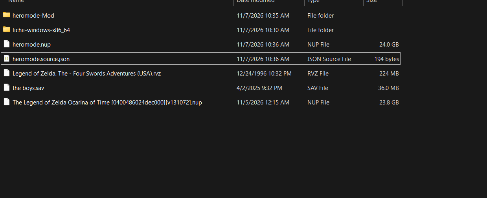

# Installation - choose ONE method

**You do not need to patch a NUP and then import a ZIP. Those are two different methods.**

## Already made heromode.nup? Your installation is done

If the builder reported success and created `heromode.nup`, that is a separate, already-patched copy of the game. In Lichii choose **File > Load File**, select **heromode.nup**, and play. No Add-on ZIP or second installation is required.

| File | Meaning | What to do |
| --- | --- | --- |
| `heromode.nup` | Game copy with the mod already applied | **Launch this in Lichii** |
| Original long-named Zelda `.nup` | Unchanged original game | Keep it; use it for Method A instead |
| `heromode-Mod/` | Generated loose mod files | Ignore when launching the patched NUP |
| `heromode.source.json` | Installer record of the original input | Not a game or mod to import |
| `heromode.title-backup.json` | Backup of the copy's display metadata | Not a game or mod to import |



Some earlier installers created only the NUP, mod folder and receipt, **without generating a ZIP**. That is not an error. Do not rebuild the game just to obtain a ZIP if your patched NUP already works.

## Method A - prepared Add-on ZIP (recommended)

**No Python, CMD, game copying or patch-building step.**

For full Item Wheel / Hero Mode with a NUP, use [Lichii build 95](https://github.com/zortos293/Lichii/releases/tag/build-94), or a loader with equivalent verified NUP LayeredFS support. The download tag says `build-94`, but About says build95; the official notes explain this naming mistake. Build95 fixes the NUP RomFS mod path missing from build93. The standalone shield also supports Add-ons on build93.

1. Download the asset ending **`-Prepared-Addon.zip`** from the selected mod release.
2. Close the game if running.
3. Right-click the **original game** in Lichii and select **Configure Game**.
4. Open **Add-ons > Import Mod from ZIP** and choose that prepared ZIP. Do not run a CMD first.
5. Enable the imported mod, click **Apply / OK**, and launch the original game.


Install only ONE complete mod. Hero Mode already includes the shield and wheel. Disable overlapping native replacements before switching. A prepared ZIP is not a game: do not select it in File > Load File.

The game keeps its normal library name with Method A. Identify the mod in **Configure Game > Add-ons**; there is no second game copy. You can alternatively use **Import Mod from Folder** on the extracted folder containing `exefs/` and/or `romfs/`.

## Method B - patched NUP fallback (older build93 or unsupported loader)

Use this only if you cannot use Method A. The optional **builder** ZIP is a different asset from `-Prepared-Addon.zip`.

Requires Python3.11+ with pip, the original matching NUP, and space for another game copy plus roughly1GB. Tested builder: Python3.14 on Windows.

1. Download the optional builder ZIP and extract it.
2. Run `Install-Windows.cmd`.
3. Select your **original** Zelda NUP as the source.
4. Choose a **new output filename**, such as `heromode.nup`. Never overwrite the original.
5. Wait for successful verification. Launch the **new NUP** directly. **Stop here: do not import a ZIP too.**

The builder copies the game and patches the copy. Current builders give the copy a distinct internal library name, such as **The Legend of Zelda: Ocarina of Time [Hero Mode with Stamina]**. The game title ID stays unchanged.

Older copies can have the same library name as the original despite different filenames. Use **File > Load File > heromode.nup**, or inspect **Configure Game > Info > Filename**. Do not identify the copy by file size alone. After changing display metadata, refresh the library or restart Lichii.

The optional Manual Shield builder instead generates an Add-on ZIP from your source. Import that generated ZIP through Add-ons. Downloading the prepared shield ZIP makes the builder unnecessary.

### Optional command-line build

```powershell
py -3 -m pip install -r requirements.txt
py -3 install.py --source "D:/Games/original.nup" --output "D:/Mods/Hero-Mode" --patched-nup "D:/Games/heromode.nup"
```

The source checkout needs `--variant hero-with-stamina`, `hero-without-stamina`, `manual-shield`, or `item-wheel`. Single-mod builder ZIPs choose their variant automatically. Omit `--patched-nup` to generate loose mod files only. Extracted sources containing `exefs/` and `romfs/` are accepted; NSP/XCI inputs are not. Output folders must be new/empty; wrong source hashes stop the build.

## Game version and controls

All mods target **0400486024DEC000**, update **131072**, executable build **E0F3CCFAF50065AE4EA01EB5AEB13B1A45DA3348**. Another game update is not automatically compatible.

Configure the controller normally. Fast GPU accuracy and asynchronous shaders were used in testing; mods do not overwrite emulator settings. See [FEATURES.md](FEATURES.md) for controls and behavior.

## Saves and uninstalling

The downloads do not add save slots or ship saves. Development tests use separate save data; that data is not included. A multi-file Continue/save menu was not added by this patch. Original and patched copies keep the same title ID, so the same emulator profile can use the same normal game save data.

Method A: disable the mod and restart. Method B: launch the original NUP instead. Do not apply both methods at once.

## Loader references

[Build95 notes](https://github.com/zortos293/Lichii/releases/tag/build-94) and [NUP LayeredFS fix](https://github.com/zortos293/Lichii/blob/222877d4f7c8945b2f31a87b76d09f0a92e4f1b8/src/core/file_sys/romfs_factory.cpp). The [older build93 path](https://github.com/zortos293/Lichii/blob/09b78bd2dfdd279cc81caed2a794ed85062725c9/src/core/file_sys/romfs_factory.cpp) bypasses NUP RomFS overrides even if the UI lists a mod.
